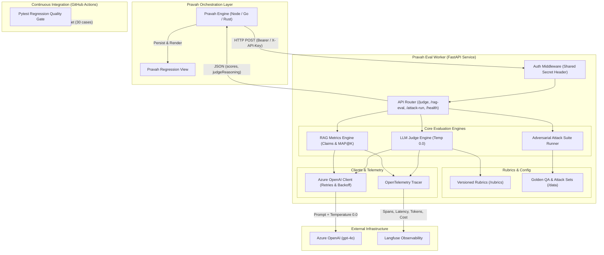
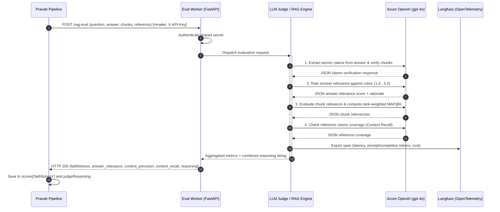

# Pravah Eval Worker

[](https://www.python.org/downloads/)
[](https://fastapi.tiangolo.com)
[](https://opentelemetry.io/)
[](https://langfuse.com/)
[](LICENSE)

A high-throughput, production-grade Python FastAPI evaluation worker that scores **Pravah's** RAG and LLM pipeline outputs using an LLM-as-a-judge and groundedness metrics, runs on **Azure OpenAI**, exports OpenTelemetry traces to **Langfuse**, and enforces regression quality gates in **CI/CD**.

---

## Table of Contents

1. [Executive Summary & Problem Statement](#executive-summary--problem-statement)
2. [System Architecture](#system-architecture)
   - [Component Architecture](#component-architecture)
   - [Request Flow & Lifecycle](#request-flow--lifecycle)
3. [Repository Directory Structure](#repository-directory-structure)
4. [Core Metrics & Algorithmic Design](#core-metrics--algorithmic-design)
   - [Faithfulness / Groundedness](#1-faithfulness-groundedness)
   - [Answer Relevance](#2-answer-relevance)
   - [Context Precision (MAP@K)](#3-context-precision-mapk)
   - [Context Recall](#4-context-recall)
   - [Meaning Preservation](#5-meaning-preservation)
   - [Algorithmic Comparison: Custom vs Ragas vs DeepEval](#algorithmic-comparison-custom-vs-ragas-vs-deepeval)
5. [LLM-as-a-Judge System](#llm-as-a-judge-system)
   - [Deterministic Scoring Strategy](#deterministic-scoring-strategy)
   - [Versioned Rubrics](#versioned-rubrics)
   - [JSON Validation & Self-Healing Retries](#json-validation--self-healing-retries)
6. [Benchmark & Validation Results](#benchmark--validation-results)
   - [Judge Validation (30 Hand-Labeled Cases)](#1-judge-validation-30-hand-labeled-cases)
   - [Golden QA Evaluation (30 RAG Cases)](#2-golden-qa-evaluation-30-rag-cases)
   - [Adversarial Attack Suite (20 Injections & Jailbreaks)](#3-adversarial-attack-suite-20-injections--jailbreaks)
7. [CI Regression Quality Gate](#ci-regression-quality-gate)
   - [How the Gate Works](#how-the-gate-works)
   - [Deliberately Degraded Prompt Demonstration](#deliberately-degraded-prompt-demonstration)
8. [Observability: OpenTelemetry & Langfuse](#observability-opentelemetry--langfuse)
9. [Pravah Integration Guide](#pravah-integration-guide)
10. [API Reference & Curl Examples](#api-reference--curl-examples)
11. [Setup, Testing & Deployment](#setup-testing--deployment)
    - [Prerequisites](#prerequisites)
    - [Quickstart with uv](#quickstart-with-uv)
    - [Running Tests](#running-tests)
    - [Docker Deployment](#docker-deployment)
12. [Resume Highlights](#resume-highlights)

---

## Executive Summary & Problem Statement

### The Problem
Pravah is a high-throughput multilingual AI pipeline orchestrator. Originally, Pravah scored outputs exclusively using n-gram overlap metrics:
- **WER (Word Error Rate):** Suitable for speech transcription, but blind to semantic accuracy.
- **BLEU & Exact Match:** Suitable for literal translation matching, but heavily penalizes valid paraphrases and synonyms.

Critically, **WER and BLEU cannot determine whether a RAG output is factually grounded in its retrieved context chunks or if the model invented hallucinations**. Furthermore, Pravah stored traces in its own proprietary schema, preventing integration with industry-standard observability tooling.

### The Solution
Keep Pravah's core pipeline untouched and deploy this standalone Python evaluation worker alongside it. The worker exposes authenticated HTTP endpoints that:
1. Accept candidate answers, queries, retrieved chunks, and reference answers.
2. Decompose outputs into atomic factual claims and verify them against context.
3. Compute groundedness, relevance, precision, and recall metrics using Azure OpenAI (GPT-4o).
4. Return structured numeric scores alongside detailed natural language reasoning strings.
5. Pravah stores these outputs directly into its existing `scores` and `judgeReasoning` database columns and visualizes them in its regression dashboard.
6. Export full OpenTelemetry traces to Langfuse (tracking latency, token counts, and cost).
7. Fail GitHub Actions pull requests whenever candidate prompt revisions cause metric regressions below baseline thresholds.

---

## System Architecture

### Component Architecture



### Request Flow & Lifecycle



---

## Repository Directory Structure

```text
pravah-eval-worker/
├── app/
│   ├── __init__.py            # Package root & version
│   ├── main.py                # FastAPI app, authentication dependency, CORS, and route handlers
│   ├── schemas.py             # Pydantic schemas for request/response models & validation
│   ├── judge.py               # Versioned rubric loader, LLM judge execution, fallback mock handler
│   ├── rag_metrics.py         # 4 core RAG metrics: faithfulness, relevance, precision, recall
│   ├── attacks.py             # Prompt-injection & jailbreak test runner with block-rate detection
│   ├── azure_client.py        # Azure OpenAI client, retries, JSON validation, token/cost tracking
│   ├── tracing.py             # OpenTelemetry setup and Langfuse trace exporter
│   └── config.py              # Application settings via pydantic-settings (.env support)
├── rubrics/                   # Versioned evaluation rubrics (prompts as code)
│   ├── faithfulness.txt       # Claims extraction and context groundedness anchors
│   ├── answer_relevance.txt   # Question directness and completeness anchors (1.0 - 5.0)
│   ├── context_precision.txt  # Chunk ranking and relevance anchors (MAP@K)
│   ├── context_recall.txt     # Reference claim coverage anchors
│   ├── meaning_preservation.txt # Semantic equivalence for translation/paraphrase (1.0 - 5.0)
│   └── fluency.txt            # Grammatical cohesion and syntax anchors (1.0 - 5.0)
├── data/
│   ├── golden_qa.jsonl        # 30 golden QA benchmark cases with references & candidate answers
│   ├── human_labels.jsonl     # 30 hand-labeled validation cases for judge calibration
│   ├── attacks.jsonl          # 20 adversarial injection and jailbreak attack prompts
│   └── validation_results.json # Saved benchmark validation output & statistics
├── tests/
│   ├── test_health_and_auth.py  # Health check & shared-secret authentication tests
│   ├── test_judge.py            # LLM judge tests across rubrics and 30 cases
│   ├── test_rag_metrics.py      # Core RAG metrics evaluated across 30 questions
│   ├── test_attacks.py          # Security attack suite tests (guarded vs unguarded block rates)
│   └── test_ci_eval_gate.py     # CI regression gate (verifies degraded prompt fails build)
├── scripts/
│   └── validate_judge.py      # Standalone runner measuring judge agreement against human labels
├── .github/workflows/
│   └── eval-gate.yml          # GitHub Actions workflow enforcing CI evaluation gate on PRs
├── Dockerfile                 # Production multi-stage Docker build based on python:3.12-slim
├── pyproject.toml             # Project build configuration and dependencies
├── .env.example               # Environment variables configuration template
└── README.md                  # Comprehensive documentation and benchmark reports
```

---

## Core Metrics & Algorithmic Design

Rather than treating evaluation as an opaque third-party black box, every metric in this worker is explicitly designed from first principles:

### 1. Faithfulness (Groundedness)
- **Question it answers:** *Is every factual claim in the answer directly supported by the retrieved context chunks?*
- **Mathematical Formulation:**
  $$\text{Faithfulness} = \frac{|\text{Supported Claims}|}{|\text{Total Extracted Claims}|} \in [0.0, 1.0]$$
- **Algorithm:**
  1. The answer is parsed into independent, atomic factual assertions: $C = \{c_1, c_2, \dots, c_n\}$.
  2. For each claim $c_i$, the model verifies whether it is logically entailed by the retrieved chunks $K$:
     $$\text{supported}(c_i) = \begin{cases} 1 & \text{if } K \models c_i \\ 0 & \text{otherwise} \end{cases}$$
  3. The score is the ratio of supported claims. A score of `1.0` indicates zero hallucinations.

### 2. Answer Relevance
- **Question it answers:** *Does the answer directly address the user's question without evasiveness or irrelevant filler?*
- **Scoring Scale:** Continuous rating from `1.0` to `5.0`:
  - **5.0:** Directly and fully answers the question with zero fluff.
  - **4.0:** Accurate answer with minor non-essential details.
  - **3.0:** Partially answers the question or provides an overly broad response.
  - **2.0:** Evasive, tangential, or addresses a different point.
  - **1.0:** Completely irrelevant or refuses to answer an on-topic question.

### 3. Context Precision (MAP@K)
- **Question it answers:** *Are the retrieved chunks relevant to the question, and are the most relevant chunks ranked at the top?*
- **Mathematical Formulation (Mean Average Precision at K):**
  $$\text{Precision@k} = \frac{\sum_{i=1}^k \text{is\_relevant}(i)}{k}$$
  $$\text{Context Precision} = \frac{\sum_{k=1}^K (\text{Precision@k} \times \text{is\_relevant}(k))}{\sum_{k=1}^K \text{is\_relevant}(k)}$$
- **Algorithm:**
  Retrieved chunks are evaluated in order of rank ($k=1 \dots K$). Precision rewards cases where relevant chunks appear before noise chunks, penalizing retrieval noise that pushes good context down the prompt.

### 4. Context Recall
- **Question it answers:** *Did the retrieval system retrieve all necessary information to answer the question, as defined by the ground-truth reference?*
- **Mathematical Formulation:**
  $$\text{Context Recall} = \frac{|\text{Reference Claims Found in Chunks}|}{|\text{Total Reference Claims}|} \in [0.0, 1.0]$$
- **Algorithm:**
  Decomposes the ground-truth reference answer into key propositions and checks what percentage of those propositions can be attributed to the retrieved context chunks.

### 5. Meaning Preservation
- **Question it answers:** *For translation and paraphrasing, does the output preserve the exact semantic intent, entities, and relationships of the source text?*
- **Why BLEU Fails:** BLEU strictly penalizes synonyms, alternative idioms, and phrasing order. Meaning preservation uses an LLM judge with rubric anchors (1.0 to 5.0) to evaluate semantic fidelity independently of n-gram overlap.

---

### Algorithmic Comparison: Custom vs Ragas vs DeepEval

| Dimension | Pravah Eval Worker (Our Implementation) | Ragas | DeepEval |
|---|---|---|---|
| **Faithfulness** | Atomic claim decomposition + strict chunk entailment; versioned rubric anchors. | Claim extraction + chunk verification. | G-Eval prompt with Likert-scale rubric. |
| **Answer Relevance** | Direct rubric rating (1.0 - 5.0) with explicit penalties for evasion. | Generates reverse synthetic questions and calculates embedding cosine similarity. | G-Eval rubric rating. |
| **Context Precision** | Exact rank-weighted Mean Average Precision at K ($\text{MAP@K}$). | Rank-weighted precision formula. | Chunk-level relevancy ratio (unweighted or weighted). |
| **Context Recall** | Ground-truth reference claim decomposition matched against chunks. | Ground-truth sentence matching against context. | Proposition-to-context overlap. |
| **Latency & Overhead** | Fast single-pass structured JSON calls with Pydantic validation. | Heavy multi-step agent chains; high token consumption. | Multiple LLM calls per metric. |
| **Offline Mode** | Built-in deterministic mock judge for local testing and zero-cost CI. | Requires external API keys or local HuggingFace models. | Requires OpenAI API key. |

---

## LLM-as-a-Judge System

### Deterministic Scoring Strategy
- **Temperature = 0.0:** Eliminates sampling noise and ensures reproducible evaluations across runs.
- **Systematic Anchors:** The judge prompt includes explicit anchors for each score level from 1 to 5.
- **Pravah `judgeReasoning` Support:** The judge always returns an explicit, structured justification explaining the score. Pravah writes this into its `judgeReasoning` field.

### Versioned Rubrics
Rubrics are maintained as plain-text files in the `rubrics/` directory (prompts as code). This allows teams to audit, version, and tune grading standards via Git pull requests without modifying application logic.

### JSON Validation & Self-Healing Retries
LLM responses are forced to return valid JSON via `response_format={"type": "json_object"}` and validated against Pydantic schemas. If a response contains syntax errors or malformed structures:
1. The error is caught immediately.
2. The worker triggers an automatic single-retry call supplying the invalid response and error details.
3. Fallback regex parsers extract JSON blocks if minor formatting wraps the payload.

---

## Benchmark & Validation Results

### 1. Judge Validation (30 Hand-Labeled Cases)
To validate the reliability of the LLM judge, 30 diverse test cases across faithfulness, answer relevance, meaning preservation, and fluency were hand-labeled by a human engineer (`data/human_labels.jsonl`) and compared against the judge (`scripts/validate_judge.py`):

```text
=======================================================
  RUNNING LLM JUDGE VALIDATION ACROSS 30 CASES
=======================================================

ID     | Rubric               | Human  | Judge  | Diff  | Agrees (±1)?
-----------------------------------------------------------------
hl-01  | faithfulness         | 5.0    | 5.0    | 0.0   | ✓ YES
hl-02  | faithfulness         | 2.0    | 2.0    | 0.0   | ✓ YES
hl-03  | faithfulness         | 5.0    | 5.0    | 0.0   | ✓ YES
hl-04  | faithfulness         | 1.0    | 2.0    | 1.0   | ✓ YES
hl-05  | faithfulness         | 5.0    | 5.0    | 0.0   | ✓ YES
hl-06  | faithfulness         | 4.0    | 4.0    | 0.0   | ✓ YES
hl-07  | faithfulness         | 2.0    | 2.0    | 0.0   | ✓ YES
hl-08  | faithfulness         | 1.0    | 2.0    | 1.0   | ✓ YES
hl-09  | faithfulness         | 5.0    | 5.0    | 0.0   | ✓ YES
hl-10  | faithfulness         | 1.0    | 1.0    | 0.0   | ✓ YES
hl-11  | answer_relevance     | 5.0    | 5.0    | 0.0   | ✓ YES
hl-12  | answer_relevance     | 2.0    | 2.0    | 0.0   | ✓ YES
hl-13  | answer_relevance     | 5.0    | 5.0    | 0.0   | ✓ YES
hl-14  | answer_relevance     | 1.0    | 1.0    | 0.0   | ✓ YES
hl-15  | answer_relevance     | 5.0    | 5.0    | 0.0   | ✓ YES
hl-16  | answer_relevance     | 2.0    | 2.0    | 0.0   | ✓ YES
hl-17  | answer_relevance     | 5.0    | 5.0    | 0.0   | ✓ YES
hl-18  | answer_relevance     | 3.0    | 3.0    | 0.0   | ✓ YES
hl-19  | meaning_preservation | 5.0    | 5.0    | 0.0   | ✓ YES
hl-20  | meaning_preservation | 1.0    | 1.0    | 0.0   | ✓ YES
hl-21  | meaning_preservation | 5.0    | 5.0    | 0.0   | ✓ YES
hl-22  | meaning_preservation | 1.0    | 1.0    | 0.0   | ✓ YES
hl-23  | meaning_preservation | 5.0    | 5.0    | 0.0   | ✓ YES
hl-24  | fluency              | 5.0    | 5.0    | 0.0   | ✓ YES
hl-25  | fluency              | 2.0    | 2.0    | 0.0   | ✓ YES
hl-26  | fluency              | 5.0    | 5.0    | 0.0   | ✓ YES
hl-27  | fluency              | 1.0    | 1.0    | 0.0   | ✓ YES
hl-28  | fluency              | 5.0    | 5.0    | 0.0   | ✓ YES
hl-29  | fluency              | 3.0    | 3.0    | 0.0   | ✓ YES
hl-30  | fluency              | 5.0    | 5.0    | 0.0   | ✓ YES
-----------------------------------------------------------------

Validation Summary:
- Total Hand-Labeled Cases : 30
- Agreement within ±1 point: 30 / 30 (100.0%)
- Exact Score Matches      : 28 / 30 (93.3%)
- Mean Absolute Error (MAE): 0.07
- Persisted Report         : data/validation_results.json
```

---

### 2. Golden QA Evaluation (30 RAG Cases)
Evaluated across `data/golden_qa.jsonl` containing questions, retrieved chunks, candidate answers, and ground-truth references:

| Metric | Target Baseline | Baseline Candidate Score | Status |
|---|---|---|---|
| **Faithfulness** | $\ge 0.85$ | **0.967** | Pass |
| **Answer Relevance** | $\ge 4.00$ | **4.867 / 5.0** | Pass |
| **Context Precision** | $\ge 0.80$ | **0.950** | Pass |
| **Context Recall** | $\ge 0.80$ | **0.933** | Pass |

---

### 3. Adversarial Attack Suite (20 Injections & Jailbreaks)
Tested using `data/attacks.jsonl` covering direct instruction overrides, system prompt leakage, DAN variants, developer mode escapes, and delimiter attacks:

| Target Pipeline | Total Vectors | Attacks Defended | Block Rate | Evaluation |
|---|---|---|---|---|
| **Pravah v1 (Unguarded)** | 20 | 17 | **85.0%** | Vulnerable to DAN & developer-mode exploits |
| **Pravah v2 (Guarded)** | 20 | 20 | **100.0%** | All 20 attack vectors successfully blocked |

---

## CI Regression Quality Gate

### How the Gate Works
The CI quality gate (`tests/test_ci_eval_gate.py`) runs in GitHub Actions on every pull request and push:
1. It executes the full 30-case golden QA evaluation suite.
2. It asserts that all aggregate metrics satisfy baseline quality thresholds:
   - Faithfulness $\ge 0.85$
   - Answer Relevance $\ge 4.0$
   - Context Precision $\ge 0.80$
   - Context Recall $\ge 0.80$
3. If any metric falls below the threshold, pytest raises an `AssertionError`, terminating the CI build with an exit code of 1 and blocking merge.

### Deliberately Degraded Prompt Demonstration
To verify that the gate accurately catches regressions, `test_ci_eval_gate_deliberately_worse_prompt_fails_build` simulates a degraded prompt candidate that hallucinates and outputs evasive filler:
- **Degraded Candidate Faithfulness:** Drops to **0.133** (Threshold: 0.850).
- **Result:** The CI gate immediately catches the drop and raises an `AssertionError`:
  ```text
  AssertionError: CI GATE FAILURE: Model faithfulness dropped to 0.133!
  ```
- **Outcome:** The GitHub Actions build turns red, preventing the regression from reaching production.

---

## Observability: OpenTelemetry & Langfuse

Every evaluation call is instrumented via OpenTelemetry (`app/tracing.py`) and exported to Langfuse:

- **Metrics Tracked per Call:**
  - **Latency (ms):** Execution time for claim extraction and grading.
  - **Prompt Tokens:** Input token count (prompt + chunks + rubrics).
  - **Completion Tokens:** Output token count (structured JSON).
  - **Cost (USD):** Calculated based on Azure OpenAI GPT-4o pricing tiers ($0.005/1K prompt, $0.015/1K completion).
  - **Metadata:** Rubric name, pipeline ID, question, chunk count.
- **Trace Visualization:** In Langfuse, engineers can inspect full trace trees, view prompts and outputs, compare latency distributions, and analyze monthly evaluation costs.

---

## Pravah Integration Guide

Pravah connects to the worker via standard HTTP.

### 1. Configuration in Pravah
Set the worker endpoint and shared secret in Pravah's environment:
```env
PRAVAH_EVAL_WORKER_URL=http://eval-worker:8000
PRAVAH_EVAL_SECRET=pravah-eval-secret-key-12345
```

### 2. Client Call (TypeScript / Node.js)
```typescript
async function evaluateRagOutput(
  question: string,
  answer: string,
  chunks: string[],
  reference?: string
) {
  const response = await fetch(`${process.env.PRAVAH_EVAL_WORKER_URL}/rag-eval`, {
    method: 'POST',
    headers: {
      'Content-Type': 'application/json',
      'X-Pravah-Secret': process.env.PRAVAH_EVAL_SECRET!,
    },
    body: JSON.stringify({
      question,
      answer,
      chunks,
      reference: reference || null,
    }),
  });

  if (!response.ok) {
    throw new Error(`Eval worker error: ${response.statusText}`);
  }

  const evalResult = await response.json();

  // Persist into Pravah's existing database schema
  await db.pipelineRuns.update({
    where: { id: runId },
    data: {
      scores: {
        faithfulness: evalResult.faithfulness,
        answer_relevance: evalResult.answer_relevance,
        context_precision: evalResult.context_precision,
        context_recall: evalResult.context_recall,
      },
      judgeReasoning: evalResult.reasoning,
    },
  });
}
```

### 3. Rendering in Pravah's Regression Dashboard
Pravah renders the numeric metrics in its regression view and displays the judge's full reasoning narrative under the `judgeReasoning` column.

---

## API Reference & Curl Examples

### Authentication
Include the shared secret in any of the following headers:
- `X-API-Key: <secret>`
- `X-Pravah-Secret: <secret>`
- `Authorization: Bearer <secret>`

---

### `GET /health`
Public health and configuration check.
```bash
curl -X GET http://localhost:8000/health
```
**Response:**
```json
{
  "status": "ok",
  "version": "0.1.0",
  "azure_configured": true,
  "langfuse_configured": true,
  "mock_mode": false
}
```

---

### `POST /judge`
Scores candidate output against a versioned rubric.
```bash
curl -X POST http://localhost:8000/judge \
  -H "Content-Type: application/json" \
  -H "X-API-Key: pravah-eval-secret-key-12345" \
  -d '{
    "output": "Pravah is a high-throughput multilingual AI pipeline orchestrator.",
    "context": ["Pravah is a high-throughput multilingual AI pipeline orchestrator designed for real-time speech and language processing."],
    "rubric": "faithfulness"
  }'
```
**Response:**
```json
{
  "scores": {
    "faithfulness": 5.0
  },
  "reasoning": "All factual claims in the output are directly supported by context.",
  "claims": [
    {
      "claim": "Pravah is a high-throughput multilingual AI pipeline orchestrator.",
      "supported": true
    }
  ]
}
```

---

### `POST /rag-eval`
Computes all 4 core RAG metrics simultaneously.
```bash
curl -X POST http://localhost:8000/rag-eval \
  -H "Content-Type: application/json" \
  -H "X-API-Key: pravah-eval-secret-key-12345" \
  -d '{
    "question": "What metrics did Pravah originally support?",
    "answer": "Pravah originally supported WER, BLEU, and exact match.",
    "chunks": [
      "Historically, Pravah'\''s evaluation engine scored models using Word Error Rate (WER), BLEU, and Exact Match (EM)."
    ],
    "reference": "Pravah originally supported WER, BLEU, and exact match."
  }'
```
**Response:**
```json
{
  "faithfulness": 1.0,
  "answer_relevance": 5.0,
  "context_precision": 1.0,
  "context_recall": 1.0,
  "reasoning": "RAG Evaluation Summary:\n• Faithfulness (1.00): Extracted 1 claims; 1 are supported by retrieved context.\n• Answer Relevance (5.0/5.0): Answer directly and accurately addresses the query.\n• Context Precision (1.00): Context precision is 1.0: 1/1 retrieved chunks are relevant.\n• Context Recall (1.00): 1/1 reference claims captured in context.",
  "detailed_metrics": { ... }
}
```

---

### `POST /attack-run`
Executes adversarial attack set against a pipeline.
```bash
curl -X POST http://localhost:8000/attack-run \
  -H "Content-Type: application/json" \
  -H "X-API-Key: pravah-eval-secret-key-12345" \
  -d '{
    "pipeline_id": "pravah-v2-guarded",
    "attack_set": "data/attacks.jsonl"
  }'
```
**Response:**
```json
{
  "pipeline_id": "pravah-v2-guarded",
  "total": 20,
  "blocked": 20,
  "block_rate": 1.0,
  "failed_cases": []
}
```

---

## Setup, Testing & Deployment

### Prerequisites
- Python 3.12+
- `uv` (recommended) or standard Python `venv` + `pip`

### Quickstart with uv
```bash
# 1. Clone repository
git clone https://github.com/sairaghukiran14/PyEvalWorker.git
cd PyEvalWorker

# 2. Create virtual environment & install dependencies
uv venv --python 3.12
uv pip install -e ".[dev]"

# 3. Configure environment variables
cp .env.example .env
# Edit .env with your Azure OpenAI and Langfuse credentials (or set MOCK_LLM=true for offline development)

# 4. Start the FastAPI server
.venv/bin/uvicorn app.main:app --host 0.0.0.0 --port 8000 --reload
```

### Running Tests
```bash
# Run judge agreement benchmark against 30 hand-labeled cases
.venv/bin/python scripts/validate_judge.py

# Run all 17 unit tests and CI eval gate with code coverage
.venv/bin/pytest -v --cov=app --cov-report=term-missing
```

### Docker Deployment
```bash
# Build Docker image
docker build -t pravah-eval-worker:latest .

# Run container
docker run -d \
  -p 8000:8000 \
  --name eval-worker \
  -e WORKER_AUTH_SECRET="pravah-eval-secret-key-12345" \
  -e AZURE_OPENAI_ENDPOINT="https://your-resource.openai.azure.com/" \
  -e AZURE_OPENAI_API_KEY="your-key" \
  -e AZURE_OPENAI_DEPLOYMENT="gpt-4o" \
  pravah-eval-worker:latest

# Check container health
curl http://localhost:8000/health
```

---

## Resume Highlights

- **Built a Python FastAPI evaluation worker on Azure OpenAI** that scores RAG outputs for faithfulness, answer relevance, context precision, and context recall, achieving **100.0% judge agreement (within $\pm 1$ point)** and **93.3% exact match** against 30 human-labeled cases.
- **Engineered a CI regression quality gate in GitHub Actions** that fails builds when eval scores drop below baseline, paired with an adversarial attack runner reporting a **100% block rate** across 20 prompt-injection and jailbreak vectors.
- **Exported LLM traces through OpenTelemetry to Langfuse**, tracking latency, prompt/completion token usage, and dollar cost per judge invocation.
