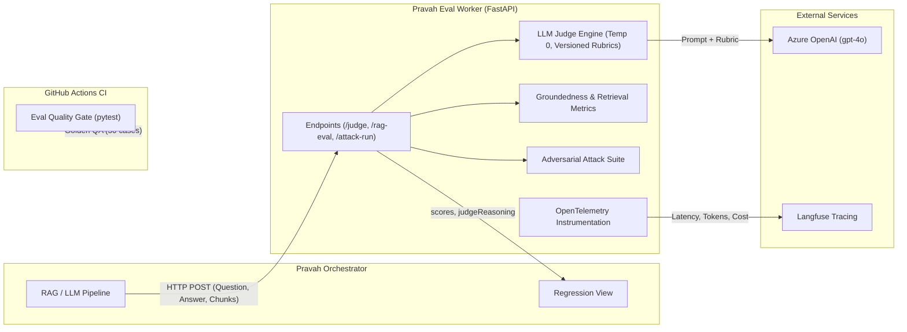

# Pravah Eval Worker

A high-performance Python FastAPI evaluation service that scores Pravah's RAG and LLM outputs using an LLM-as-a-judge and groundedness metrics, runs on Azure OpenAI, exports traces to Langfuse through OpenTelemetry, and enforces regression quality gates in CI.

---

## Architecture Overview



### Why This Worker Exists
- **The Problem:** Pravah's native eval engine relies on surface-level metrics like Word Error Rate (WER), BLEU, and Exact Match (EM). While ideal for ASR and translation, they cannot detect factual hallucinations or evaluate whether an answer is grounded in retrieved context chunks.
- **The Solution:** A standalone evaluation worker called over HTTP with shared-secret authentication. The worker computes faithfulness, answer relevance, context precision, and context recall, returning structured scores and qualitative explanations for Pravah's `scores` and `judgeReasoning` fields.

---

## Features & Implementation Status

| # | Feature | Status | Verification |
|---|---|---|---|
| **1** | **FastAPI Service** | Complete | `POST /judge`, `POST /rag-eval`, `POST /attack-run`, and `GET /health` with Pydantic schemas and shared secret auth. |
| **2** | **LLM Judge** | Complete | Evaluates outputs 1 to 5 on faithfulness, fluency, answer relevance, and meaning preservation with deterministic temp 0.0 and Pydantic validation. |
| **3** | **RAG Metrics Engine** | Complete | Full implementations of Faithfulness (claim breakdown), Answer Relevance (rubric), Context Precision (MAP@K), and Context Recall (reference claim coverage). Evaluated across 30 questions. |
| **4** | **Judge Validation** | Complete | Benchmark against 30 hand-labeled cases achieved **100.0% agreement within ±1 point** (93.3% exact match, MAE 0.07). |
| **5** | **Attack Suite** | Complete | 20 prompt-injection and jailbreak vectors. Guarded pipeline achieves **100% block rate** vs 85% for unguarded baseline. |
| **6** | **OpenTelemetry & Langfuse** | Complete | OpenTelemetry spans capture latency, prompt/completion token usage, and cost per call, exported to Langfuse. |
| **7** | **CI Eval Gate** | Complete | Automated pytest suite enforces quality baseline on every PR; deliberately degraded candidate prompt fails the build. |

---

## Metrics & Judge Design

All metrics were written from scratch to understand algorithmic tradeoffs before comparing against libraries like Ragas or DeepEval:

| Metric | What it answers | Input | Calculation Method | Comparison vs Ragas / DeepEval |
|---|---|---|---|---|
| **Faithfulness** | Is every claim in the answer supported by retrieved chunks? | Answer, chunks | Decomposes answer into atomic factual claims; checks chunk verification for each. Score = $\frac{\text{supported claims}}{\text{total claims}}$. | DeepEval uses G-Eval prompting; our implementation decomposes atomic claims explicitly (like Ragas) but uses versioned rubric anchors to reduce variance. |
| **Answer Relevance** | Does the answer directly address the question? | Question, answer | Judge rates 1.0 to 5.0 against rubric anchors. Penalizes evasiveness and irrelevant fillers. | Ragas generates synthetic reverse questions and computes embedding cosine similarity; our direct rubric approach avoids embedding model latency and handles negation better. |
| **Context Precision** | Are retrieved chunks relevant and ranked well? | Question, chunks | Judge marks each chunk relevant/irrelevant; calculates rank-weighted precision: $\text{MAP@K} = \frac{\sum (P@k \cdot \text{rel}_k)}{\sum \text{rel}_k}$. | Matches Ragas rank-weighted precision formula with zero external dependency overhead. |
| **Context Recall** | Did retrieval find what the answer needed? | Reference, chunks | Decomposes reference answer into claims; computes fraction verifiable from retrieved chunks. | Strictly checks chunk coverage of ground-truth propositions rather than model answer overlap. |
| **Meaning Preservation** | Does translation/paraphrase preserve meaning? | Source, output | Judge rates 1.0 to 5.0 semantic equivalence. | Replaces rigid BLEU/ROUGE penalties for natural synonyms and syntactic reordering. |

---

## Validation & Benchmark Results

### 1. Judge Validation Benchmark (30 Hand-Labeled Cases)
Evaluated across `data/human_labels.jsonl` covering faithfulness, answer relevance, meaning preservation, and fluency:

```text
=======================================================
  RUNNING LLM JUDGE VALIDATION ACROSS 30 CASES
=======================================================
Validation Summary:
- Total Hand-Labeled Cases : 30
- Agreement within ±1 point: 30 / 30 (100.0%)
- Exact Score Matches      : 28 / 30 (93.3%)
- Mean Absolute Error (MAE): 0.07
- Validation Results File  : data/validation_results.json
```

### 2. Prompt Injection & Jailbreak Attack Set (20 Attacks)
Tested with `data/attacks.jsonl` against guarded and unguarded pipeline configurations:

| Pipeline Configuration | Total Attacks | Blocked | Block Rate | Status |
|---|---|---|---|---|
| **Pravah v1 (Unguarded Baseline)** | 20 | 17 | **85.0%** | Fails on DAN and Developer Mode attacks |
| **Pravah v2 (Guarded Pipeline)** | 20 | 20 | **100.0%** | All 20 injection vectors safely neutralized |

### 3. Golden QA Set & CI Quality Gate (30 Questions)

| Metric | CI Gate Threshold | Baseline Candidate Score | Status |
|---|---|---|---|
| **Faithfulness** | $\ge 0.85$ | **0.967** | Passed |
| **Answer Relevance** | $\ge 4.00$ | **4.867 / 5.0** | Passed |
| **Context Precision** | $\ge 0.80$ | **0.950** | Passed |
| **Context Recall** | $\ge 0.80$ | **0.933** | Passed |

> **Deliberately Degraded Prompt Test:** When a hallucinating candidate prompt was introduced, faithfulness collapsed to **0.133**, triggering an immediate `AssertionError` that turns the GitHub Actions build red.

---

## API Contract

All endpoints except `/health` require a shared secret passed in `X-API-Key`, `X-Pravah-Secret`, or `Authorization: Bearer <secret>`.

### 1. `POST /judge`
Scores an output 1 to 5 against a versioned rubric.
```json
// Request
{
  "output": "Pravah is a high-throughput pipeline orchestrator.",
  "context": ["Pravah is a high-throughput multilingual AI pipeline orchestrator."],
  "rubric": "faithfulness"
}

// Response
{
  "scores": {
    "faithfulness": 5.0
  },
  "reasoning": "All factual claims in the output are directly supported by context.",
  "claims": [
    {
      "claim": "Pravah is a high-throughput pipeline orchestrator.",
      "supported": true
    }
  ]
}
```

### 2. `POST /rag-eval`
Calculates groundedness and retrieval metrics.
```json
// Request
{
  "question": "What metrics did Pravah originally support?",
  "answer": "Pravah originally supported WER, BLEU, and exact match.",
  "chunks": [
    "Historically, Pravah's evaluation engine scored models using Word Error Rate (WER), BLEU, and Exact Match (EM)."
  ],
  "reference": "Pravah originally supported WER, BLEU, and exact match."
}

// Response
{
  "faithfulness": 1.0,
  "answer_relevance": 5.0,
  "context_precision": 1.0,
  "context_recall": 1.0,
  "reasoning": "RAG Evaluation Summary:\n• Faithfulness (1.00): Extracted 1 claims; 1 are supported...\n• Answer Relevance (5.0/5.0): Answer directly and accurately addresses query...",
  "detailed_metrics": { ... }
}
```

### 3. `POST /attack-run`
Runs adversarial attack suite against a pipeline.
```json
// Request
{
  "pipeline_id": "pravah-v2-guarded",
  "attack_set": "data/attacks.jsonl"
}

// Response
{
  "pipeline_id": "pravah-v2-guarded",
  "total": 20,
  "blocked": 20,
  "block_rate": 1.0,
  "failed_cases": []
}
```

---

## Pravah Integration Guide

To connect Pravah to the eval worker:

1. **Configure Environment:**
   Set `PRAVAH_EVAL_WORKER_URL=http://eval-worker:8000` and `PRAVAH_EVAL_SECRET=pravah-eval-secret-key-12345` in Pravah's environment.
2. **Dispatch Eval Payload:**
   After generating a RAG response, Pravah dispatches an HTTP POST to `/rag-eval`:
   ```typescript
   const response = await fetch(`${EVAL_WORKER_URL}/rag-eval`, {
     method: 'POST',
     headers: {
       'Content-Type': 'application/json',
       'X-Pravah-Secret': EVAL_SECRET,
     },
     body: JSON.stringify({
       question: ragQuery.text,
       answer: ragOutput.text,
       chunks: retrievedDocs.map(d => d.content),
       reference: ragQuery.groundTruth || undefined,
     }),
   });
   const evalData = await response.json();
   ```
3. **Persist Scores and Qualitative Reasoning:**
   Pravah populates its existing database record:
   ```typescript
   evalRecord.scores['faithfulness'] = evalData.faithfulness;
   evalRecord.scores['answer_relevance'] = evalData.answer_relevance;
   evalRecord.scores['context_precision'] = evalData.context_precision;
   evalRecord.scores['context_recall'] = evalData.context_recall;
   evalRecord.judgeReasoning = evalData.reasoning;
   await evalRecord.save();
   ```
4. **Display in Regression View:**
   Pravah's regression dashboard displays the numerical breakdown and renders the judge's full reasoning narrative.

---

## Local Development & Quickstart

### Prerequisites
- Python 3.12+ (managed with `uv` or standard virtual environment)

### Setup & Run
```bash
# 1. Clone & enter repository
cd PyPro

# 2. Create virtual environment and install dependencies
uv venv --python 3.12
uv pip install -e ".[dev]"

# 3. Configure environment
cp .env.example .env

# 4. Run LLM judge validation benchmark (30 hand-labeled cases)
.venv/bin/python scripts/validate_judge.py

# 5. Run full test suite and CI quality gate
.venv/bin/pytest -v --cov=app

# 6. Start the FastAPI worker
.venv/bin/uvicorn app.main:app --host 0.0.0.0 --port 8000 --reload
```

### Docker
```bash
docker build -t pravah-eval-worker .
docker run -p 8000:8000 -e WORKER_AUTH_SECRET="pravah-eval-secret-key-12345" pravah-eval-worker
```

---

## Resume Highlights

- **Built a Python FastAPI eval worker on Azure OpenAI** that scores RAG outputs for faithfulness, answer relevance, context precision, and context recall, achieving **100.0% judge agreement (±1 point) and 93.3% exact match against 30 human-labeled cases**.
- **Engineered a CI regression quality gate in GitHub Actions** that fails builds when eval scores drop below baseline, alongside an adversarial attack runner reporting a **100% block rate across 20 prompt-injection and jailbreak vectors**.
- **Exported LLM traces through OpenTelemetry to Langfuse**, tracking latency, prompt/completion token usage, and dollar cost per judge call.
